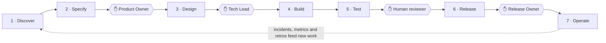

# 🤖 Claude Superskills v2.0.8


# Agentic SDLC

### A software delivery lifecycle where AI agents do the work, humans make the decisions, and every requirement is proven.

> **In development** on branch `claude/agentic-sdlc-handoff`. Not released yet. [Where it stands](#status).

---

## The problem

Coding agents produce code in minutes. Speed alone does not answer the questions a team is accountable for:

| The question | The Agentic SDLC answer |
|---|---|
| Did we build what was asked? | A spec with numbered acceptance criteria, approved before code |
| Is "done" really done? | Fresh command output for each criterion; the reviewer's default verdict is NO-GO |
| Who checked the agent's work? | Acceptance tests designed from the spec and a reviewer that never wrote the code |
| Who approved it? | Four named human sign-offs, bound to the exact version approved |
| What stops an agent going in circles? | Numeric loop limits, then escalation |
| Is a bug fix buried in ceremony? | Three paths sized by change size and risk |

## How it works



| Stage | What happens | What it leaves behind |
|---|---|---|
| **1 · Discover** | Triage, duplicate check, size and risk score, success indicator | Scored issue |
| **2 · Specify** | Acceptance criteria, UX states, security notes, critique | `spec.md` |
| **3 · Design** | Architecture decisions, tasks of at most one day, dependency graph | `plan.md`, ADRs |
| **4 · Build** | Test first, one task per fresh context | Commits traced to tasks and criteria |
| **5 · Test** | Independent acceptance tests and multi-lens review | Pull request with evidence |
| **6 · Release** | Rollback rehearsal, go/no-go checklist | Release notes, runbook |
| **7 · Operate** | Alerts, indicator reading, incidents, retrospective | Ops record, postmortems, retro |

## The team: 13 agents

A **Scrum Master** agent runs the flow: it reads the state of the work, picks the path, calls the right specialist and asks the human for each sign-off.

| Stage | Agents |
|---|---|
| Orchestration | **Scrum Master** |
| Discover and Specify | **Analyst** · Product Manager · UX Designer · Security Auditor |
| Design | **Planner** · Architect |
| Build | **Developer** · Tech Writer |
| Test | **Reviewer** · Test Engineer · Security Auditor |
| Release and Operate | Release Engineer · SRE |

Core agents are in bold; the others join only when the change needs them. The Reviewer does not edit code. The Test Engineer designs tests without seeing the implementation.

## Three paths, sized to the risk

| Path | Typical change | Human sign-offs |
|---|---|---|
| **Quick** | Bug or small task | Test (plus Release if it goes to production) |
| **Standard** | Story or feature | Specify, Design, Test, Release |
| **Full** | Epic, high-risk, regulated or legacy modernization | All four, plus a second human reviewer |

Authentication, personal data, money, public APIs, schema changes, irreversible actions and regulated work raise the path.

## What sets it apart

- **Evidence over claims.** A "done" from an agent is checked by re-running the commands.
- **Checks that are code.** Scripts validate the spec, the task graph, the starting state and the run history, with automated tests.
- **Bounded autonomy.** For example, 5 build-test rounds or 3 review-fix rounds, then a human or the Architect.
- **End to end.** It continues past the merge into release, operations and learning.
- **Traceable.** Requirement → task → commit → test → release.
- **Brownfield ready.** Pin current behaviour with tests before changing it.

## Measured against nine other methods

We fixed a [scoring methodology](docs/research/scoring/methodology.md) first: 16 criteria, levels that require evidence, five weighting profiles and a pre-registered superiority test. Then we scored ten methods.

| Method | Score (0–100) | |
|---|---:|---|
| **Agentic SDLC** | **88.5** | `██████████████████` |
| AWS AI-DLC | 68.6 | `██████████████` |
| Agile V | 67.0 | `█████████████` |
| BMad Method | 66.8 | `█████████████` |
| Addy Osmani agent-skills | 57.6 | `████████████` |
| Superpowers | 56.0 | `███████████` |
| AWS Kiro | 44.4 | `█████████` |
| Matt Pocock skills | 43.8 | `█████████` |
| GitHub Spec Kit | 43.2 | `█████████` |
| OpenSpec | 38.8 | `████████` |

First place under all five profiles. Agreement between scorers was high (Krippendorff's α = 0.877). [Full results](docs/research/scoring/results.md).

**Read the score with these limits:**

- It is an internal evaluation: our methodology, AI agents as scorers, no external review.
- The Agentic SDLC was scored as a design (risk-adjusted); the others as released products.
- The first round failed (53.2). The gaps were closed and it was scored again against the same criteria.
- It compares documented mechanisms, not productivity or defect rates.
- Others still lead on some criteria, such as ease of adoption (BMad) and human governance (Agile V).

## Status

| Milestone | State |
|---|---|
| Research of existing methods | ✅ Done |
| Scoring and gap closure | ✅ Done |
| Build: 20 skills, 13 agents, templates, check scripts | ✅ Done |
| End-to-end trial, Quick and Standard paths | ✅ Both completed, Standard with workarounds |
| Fix trial findings | 🔄 Critical fixed (re-test pending); Important: 2 of 14 fixed; 14 Minor open |
| Pilot on a real project with a team | ⬜ Next |
| Release v3.0.0 | ⬜ Next |

Details: [trial report](docs/research/2026-11-25-dogfood-report.md) · [handoff](docs/handoff/README.md).

## Try it

```bash
git clone -b claude/agentic-sdlc-handoff https://github.com/ericgandrade/claude-superskills
cd /path/to/your-project
claude --plugin-dir /path/to/claude-superskills
```

Then ask: *"Run the Agentic SDLC on this bug: ..."*

## Learn more

| | |
|---|---|
| [Method guide](docs/guides/agentic-sdlc.md) | The whole method and its mapping to software engineering standards |
| [Quickstart](skills/agentic-sdlc/references/quickstart.md) | Your first change |
| [Worked example](skills/agentic-sdlc/examples/worked-example/) | A feature from spec to retrospective |
| [Research](docs/research/) | Methods studied, scoring and audits |
| [Skills library and installation](docs/skills-library.md) | The 33 skills, including utilities outside the method |

## License

MIT. Ideas and adapted content from other projects are credited in [THIRD_PARTY_NOTICES.md](THIRD_PARTY_NOTICES.md).

---

*Version 2.0.8 | May 2026*
