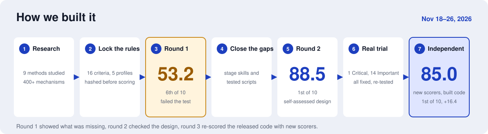
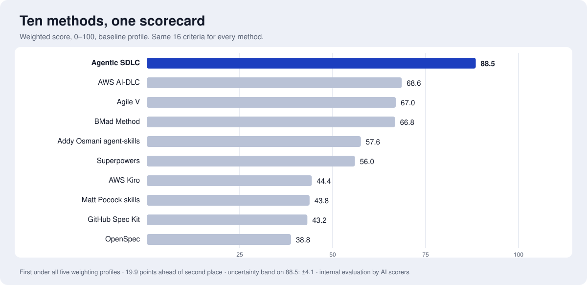
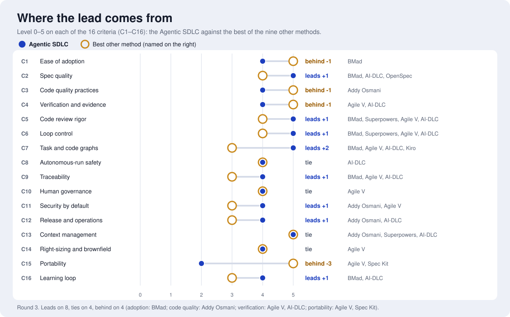
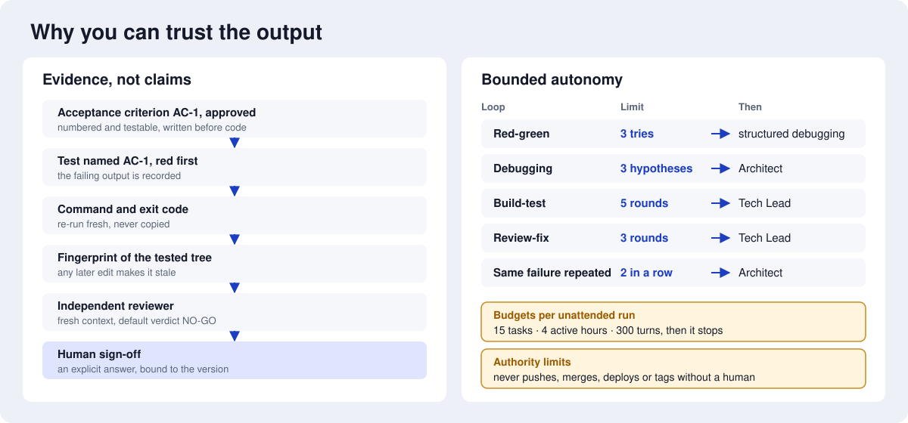

# 🤖 Claude Superskills v3.0.0: the Agentic SDLC


### A software delivery lifecycle where AI agents do the work, humans make the decisions, and every requirement is proven.

Coding agents write code in minutes. The Agentic SDLC makes that code something a team can **trust, approve and ship**: every requirement is written down before code, every claim of "done" comes with fresh evidence, a reviewer that never wrote the code checks it, and a named person signs off at each stage.

It runs inside the AI tools developers already use: Claude Code, GitHub Copilot CLI, OpenAI Codex, Gemini CLI, Cursor and three more.


---

## Why we built it

Claude Superskills started as a library of useful AI skills. In November 2026 we went back to it with one question: **what would a complete, defensible method for delivering software with AI agents look like?**

Speed does not answer the questions a team is accountable for:

| The question | The Agentic SDLC answer |
|---|---|
| Did we build what was asked? | A spec with numbered acceptance criteria, approved before code |
| Is "done" really done? | Fresh command output for each criterion; the reviewer's default verdict is NO-GO |
| Who checked the agent's work? | Acceptance tests designed from the spec, and a reviewer that never wrote the code |
| Who approved it? | Four named human sign-offs, bound to the exact version approved |
| What stops an agent going in circles? | Numeric loop limits, then escalation to a person |
| Is a one-line fix buried in ceremony? | Three paths sized by change size and risk |

We did not want another opinion. We wanted a method that could be measured against the best existing ones and win on evidence, so we fixed the rules first and let the scores decide.



1. **Research.** We studied nine leading methods and inventoried more than 400 of their mechanisms ([inventory](docs/research/inventory/), [methods](docs/research/methods/)).
2. **Freeze the rules.** The [scoring methodology](docs/research/scoring/methodology.md) was written and hashed before any scoring, without reading our own proposal.
3. **Round 1 failed.** Our design scored 53.2 and ranked 6th ([round 1](docs/research/scoring/round1-agentic-sdlc/results-round1.md)). That told us exactly which mechanisms were missing.
4. **Close the gaps.** We built them as stage skills and dependency-free scripts with automated tests, not as promises.
5. **Round 2: first place.** 88.5 against 68.6 for the runner-up ([results](docs/research/scoring/results.md)).
6. **Real trial.** We ran the method end to end on a real change. It found 1 Critical and 14 Important gaps; all are fixed and the Critical one was re-tested ([trial report](docs/research/2026-11-25-dogfood-report.md)).

## How it measures up



**How the scoring works.** 16 criteria, each with levels that need evidence (a quoted rule, a script, a template), never claims. Five weighting profiles (baseline, equal, startup, regulated enterprise, autonomous scale), so no single weighting decides the result. Two independent AI scorers per method, a red-team audit of every card and an adjudicator for disputes; agreement between scorers was high (Krippendorff's α = 0.877). A pre-registered superiority test with seven conditions. Anything not yet built was scored as design and discounted.

| Method | Maker | Score | Why it scored this way |
|---|---|---:|---|
| **Agentic SDLC** | This repository | **88.5** | Top marks on spec quality, code quality, verification, review, loop control, task graphs and context management. Lowest on human governance (3.0) and traceability (3.5), where enforcement scripts are not built yet. No criterion below 3. |
| [AWS AI-DLC](https://github.com/awslabs/aidlc-workflows) | AWS Labs | 68.6 | Evidence bound to commits, good context management. Heavy to adopt (about 19k words to start), security is conditional, needs its own runtime. |
| [Agile V](https://agile-v.org) | Christopher Koch | 67.0 | Strong verification and portability, solid human governance. No non-goals in specs, human-gated by design, little on release and learning. |
| [BMad Method](https://github.com/bmad-code-org/BMAD-METHOD) | BMad Code | 66.8 | Easiest to adopt: one entry point and a short core. Security is opt-in, the flow ends at a local commit, needs Python tooling. |
| [Addy Osmani agent-skills](https://github.com/addyosmani/agent-skills) | Addy Osmani | 57.6 | Excellent TDD and code-quality guidance. No retrospective loop; review, loops, autonomy and traceability are thin. |
| [Superpowers](https://github.com/obra/superpowers) | Jesse Vincent | 56.0 | Very good context discipline and TDD. Stops at the pull request: nothing on release or operations, little on security. |
| [AWS Kiro](https://kiro.dev) | AWS | 44.4 | Easy to start, good context handling; scored from documentation, as it is a closed product. Tests optional, approvals not recorded, little on operations. |
| [Matt Pocock skills](https://github.com/mattpocock/skills) | Matt Pocock | 43.8 | Sharp context hygiene. No Definition of Done, almost nothing on security or operations. |
| [GitHub Spec Kit](https://github.com/github/spec-kit) | GitHub | 43.2 | Three commands to start, runs on 40+ agents. Tests optional, weak review, no learning loop. |
| [OpenSpec](https://github.com/Fission-AI/OpenSpec) | Fission AI | 38.8 | Precise change specs (SHALL / WHEN-THEN deltas). No unattended mode, no learning loop, little traceability or security. |

Baseline profile, 0–100. All profiles, per-criterion tables and every scorecard: [results](docs/research/scoring/results.md) · [scorecards](docs/research/scoring/scores/).

### Where the lead comes from



It is **first under all five profiles**, 19.9 points ahead of second place (uncertainty band on the 88.5: ±4.1), and best or tied on 13 of 16 criteria, including all five core ones. The lead comes from mechanisms that run:

- **Specs that are checked.** `spec-lint` rejects a spec without testable criteria, non-goals, a rollback command or an alert threshold.
- **Evidence bound to the code.** Every claim carries the command, its exit code and a fingerprint of the tested tree; stale evidence is re-run, never reused.
- **Independent tests and review.** Acceptance tests are designed from the spec before code exists; four review lenses run in fresh contexts, and every finding is verified before it counts.
- **A task graph.** `plan-graph` checks dependencies and cycles and shows which tasks can run in parallel.
- **End to end.** It continues past the merge into rollback rehearsal, alerts, incidents and retrospectives that change files.

Others still lead on three criteria: **ease of adoption** (BMad), **human governance** (Agile V) and **portability** (Agile V and Spec Kit). Those gaps are on the [roadmap](#whats-next).

**Read the score with these limits.** It is an internal evaluation: our methodology, AI agents as scorers, no external review, and the method's owner ran the scoring round. The Agentic SDLC was scored as a partly built design, the others as released products; the methodology calls for a fresh re-score of the built method by new scorers, which is planned. It compares documented and implemented mechanisms, not productivity or defect rates in the field. The score predates the end-to-end trial.

## How it works

| Stage | What happens | What it leaves behind | Human sign-off |
|---|---|---|---|
| **1 · Discover** | Triage, duplicate check, size and risk score, success indicator | Scored issue | |
| **2 · Specify** | Acceptance criteria, UX states, security notes, critique | `spec.md` | Product Owner |
| **3 · Design** | Architecture decisions, tasks of at most one day, dependency graph | `plan.md`, ADRs | Tech Lead |
| **4 · Build** | Test first, one task per fresh context, bounded fix loops | Commits traced to tasks and criteria | |
| **5 · Test** | Independent acceptance tests and multi-lens review | Pull request with evidence | Human reviewer |
| **6 · Release** | Rollback rehearsal, go/no-go checklist | Release notes, runbook | Release Owner |
| **7 · Operate** | Alerts, indicator reading, incidents, retrospective | Ops record, postmortems, retro | |

A sign-off counts only when a person answers in a later turn. Silence is never approval, and editing an approved spec or plan voids its sign-off.

### Three paths, sized to the risk

| Path | Typical change | Human sign-offs |
|---|---|---|
| **Quick** | Bug or small task | Test (plus Release if it goes to production) |
| **Standard** | Story or feature | Specify, Design, Test, Release |
| **Full** | Epic, high-risk, regulated or legacy modernization | All four, plus a second human reviewer |

Authentication, personal data, money, public APIs, schema changes, irreversible actions and regulated work raise the path regardless of size.

### Why you can trust the output



Every limit above is enforced by a script (`run-ledger`, `preflight`), not just written in a prompt, and each script ships with automated tests (126 of them).

## The team: 13 agents

A **Scrum Master** agent runs the flow. It reads the state of the work from files in the repository, picks the path, calls the right specialist and asks a human for each sign-off.

| Agent | Job | Joins when |
|---|---|---|
| **Scrum Master** | Routes the work, tracks state, requests sign-offs, removes blockers | Always |
| **Analyst** | Scores size and risk, writes the spec and its acceptance criteria | Always |
| Product Manager | Problem, expected outcome, success indicator | New capability or unclear value |
| UX Designer | Journeys, screen states, accessibility | A user-facing surface changes |
| **Planner** | Splits the work into tasks of at most a day, with a dependency graph | Standard and Full paths |
| Architect | Hard-to-reverse decisions, recorded as ADRs | New component, data model or integration |
| **Developer** | Test first, one task per fresh context | Always |
| **Test Engineer** | Designs acceptance tests from the spec, without seeing the code | Standard and Full paths |
| **Reviewer** | Independent multi-lens review; never edits code; default verdict NO-GO | Always |
| Security Auditor | Threat model and security review | Auth, personal data, money, public API |
| Tech Writer | User docs and release notes | Users or operators see a change |
| Release Engineer | Rollback rehearsal, go/no-go, deploy | The change ships |
| SRE | Alerts, incidents, postmortems | The change runs in production |

Core agents are in bold. The others join only when the change needs them, so a small fix never pays for a full team.

## A day with the Agentic SDLC

**Morning: a bug report.** *"The orders page shows dates in UTC."* You ask: *"Fix issue #142 with the Agentic SDLC."*

1. The Analyst scores it: two files, no risk trigger → **Quick path**. It adds one acceptance criterion to the issue, in Given/When/Then form.
2. The Developer writes a test named after that criterion, runs it and records the **red** output. Only then does it change code, until the test is green and the project's Definition of Done (lint, types, tests, coverage floor) passes.
3. The pull request carries a Verification table: command, exit code and a fingerprint of the exact tree that was tested.
4. A Reviewer in a fresh context, which never saw the Developer's reasoning, checks the change against the criterion.
5. You read the evidence and approve. That is your only step, and it comes with proof attached.

**Afternoon: a feature.** *"Let customers export their orders as CSV."* Money is involved, so the path is **Standard**.

1. The Analyst writes `spec.md` with numbered criteria and non-goals, and a fresh-context critique challenges it. **The Product Owner approves the spec.**
2. The Planner and Architect produce `plan.md`: tasks, files, dependencies and decisions. **The Tech Lead approves the plan.**
3. The Test Engineer writes acceptance tests from the spec alone, before any code exists. They stay on a side branch until the Test stage.
4. The Developer works task by task. Every failed attempt is logged; the loop limits above decide when a person steps in. No silent loops.
5. At Test, the acceptance tests are merged and must pass, and four review lenses run: spec, correctness and design, security, adversarial. **A human reviewer approves.**
6. Release rehearses the rollback on the same commit and checks that the alert fires. **The Release Owner approves.** The retrospective turns lessons into file changes.

Every step leaves a file in the repository, so any session, or any person, can pick up where the last one stopped. The full feature is in the [worked example](skills/agentic-sdlc/examples/worked-example/).

## Get started

**Claude Code (plugin, recommended):** inside a `claude` session:

```text
/plugin marketplace add ericgandrade/claude-superskills
/plugin install claude-superskills@claude-superskills
```

**Any of the 8 supported platforms (npm installer):**

```bash
npx claude-superskills --bundle agentic-sdlc -y
```

Then, in your project, ask: *"Set up the Agentic SDLC here"*, followed by *"Fix issue #142 with the Agentic SDLC."* The [quickstart](skills/agentic-sdlc/references/quickstart.md) walks through the first change.

## What's in v3.0.0

| Delivered | |
|---|---|
| The method | 20 skills: the `agentic-sdlc` router and 19 stage skills from Discover to Operate |
| The team | 13 agent briefs, from Scrum Master to SRE |
| The checks | `spec-lint`, `plan-graph`, `preflight`, `run-ledger`, `budget-check`: dependency-free Node scripts, 126 automated tests |
| The templates | spec, plan, acceptance tests, PR body, release notes, runbook, retro, threat model, CI and CODEOWNERS |
| The proof | A worked example from spec to retro, a scored comparison with nine methods, an end-to-end trial |

## What's next

| Next | Why |
|---|---|
| Pilot with a real team | The trial was run by agents playing every role; a team pilot measures it in practice |
| Independent re-score of the built method | The methodology requires it; new scorers, same frozen rules |
| Approval and trace checks in CI (`approval-check`, `trace-check`) | Closes the two discounted criteria, human governance and traceability |
| Unattended loop driver, Ralph-style | Lets a run continue across fresh agent sessions without a person pressing Enter, inside the same limits and sign-offs ([study](docs/research/2026-11-25-ralph-loop-study.md)) |
| Easier adoption | The criterion where BMad still leads |

Full plan with projected score gains: [roadmap](docs/plans/2026-11-25-roadmap-v3.md).

## Also in this repository

Three skills support the method and work on their own: `skill-creator` (build and test skills), `agent-skill-discovery` (list installed skills, agents and MCP servers) and `agent-skill-orchestrator` (plan a task across installed resources; it proposes the Agentic SDLC for software work).

The research, content and document skills of earlier versions moved to [knowledge-superskills](https://github.com/ericgandrade/knowledge-superskills). Bundles, all platforms and the catalog: [skills library](docs/skills-library.md).

## Learn more

| | |
|---|---|
| [Method guide](docs/guides/agentic-sdlc.md) | The whole method and its mapping to ISO/IEC/IEEE 12207, IEC 62304 and NIST SSDF |
| [Quickstart](skills/agentic-sdlc/references/quickstart.md) | Your first change |
| [Worked example](skills/agentic-sdlc/examples/worked-example/) | A feature from spec to retrospective |
| [Research](docs/research/) | Methods studied, scoring, audits and the trial report |
| [Skills library and installation](docs/skills-library.md) | The 23 skills, bundles and every platform |

## License

MIT. Ideas and adapted content from other projects are credited in [THIRD_PARTY_NOTICES.md](THIRD_PARTY_NOTICES.md).

---

*Version 3.0.0 | November 2026*
