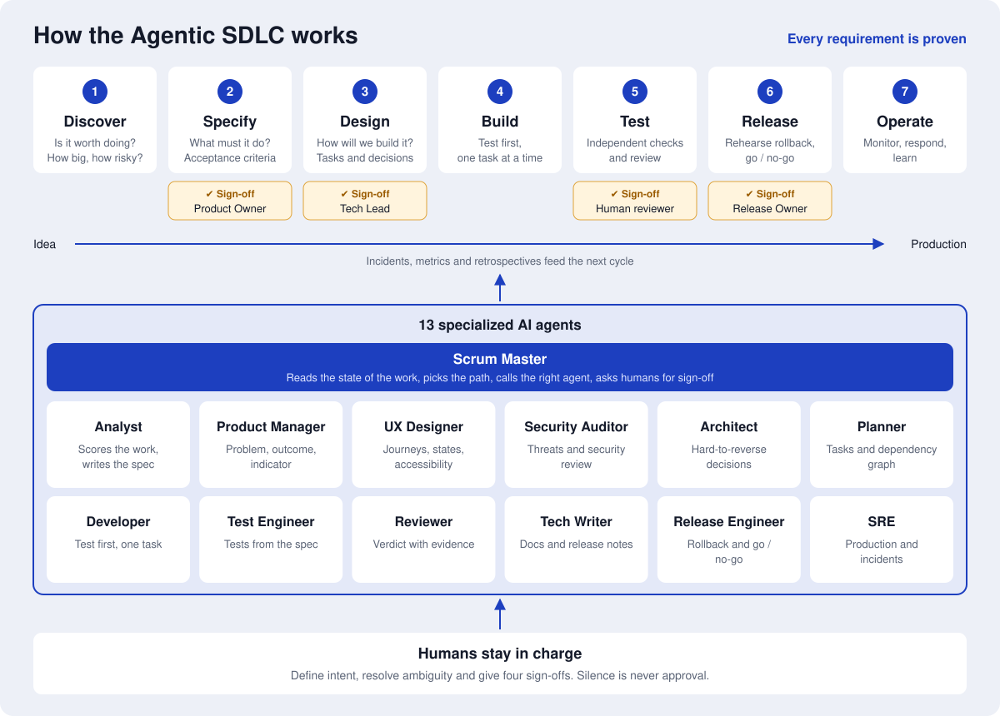

# 🤖 Claude Superskills v2.0.8


# Agentic SDLC

### A software delivery lifecycle where AI agents do the work, humans make the decisions, and every requirement is proven.

> **In development** on branch `claude/agentic-sdlc-handoff`. Not released yet. [Where it stands](#status).

---

## Why we built it

Claude Superskills started as a library of useful AI skills: planning, research, document tools. In November 2026 we went back to it with one question: **what would a complete, defensible method for delivering software with AI agents look like?**

Coding agents write code in minutes. Speed does not answer the questions a team is accountable for:

| The question | The Agentic SDLC answer |
|---|---|
| Did we build what was asked? | A spec with numbered acceptance criteria, approved before code |
| Is "done" really done? | Fresh command output for each criterion; the reviewer's default verdict is NO-GO |
| Who checked the agent's work? | Acceptance tests designed from the spec and a reviewer that never wrote the code |
| Who approved it? | Four named human sign-offs, bound to the exact version approved |
| What stops an agent going in circles? | Numeric loop limits, then escalation to a person |
| Is a one-line fix buried in ceremony? | Three paths sized by change size and risk |

We did not want another opinion. We wanted a method that could be measured against the best existing ones and win on evidence. So we worked in this order:

| When (2026) | Step | Result |
|---|---|---|
| Nov 18–19 | Studied the leading methods and standards and inventoried their mechanisms | 400+ mechanisms catalogued ([inventory](docs/research/inventory/), [methods](docs/research/methods/)) |
| Nov 20 | **Froze a scoring methodology before scoring anything**, hashed so it could not drift | 16 criteria, 5 weighting profiles, a pre-registered superiority test ([methodology](docs/research/scoring/methodology.md)) |
| Nov 20–22 | Round 1: independent AI scorers rated all ten methods; a red team audited the cards | **Our design scored 53.2 and ranked 6th.** It failed. ([round 1](docs/research/scoring/round1-agentic-sdlc/results-round1.md)) |
| Nov 22–23 | Closed the gaps by building the mechanisms as stage skills and tested scripts, not as promises | Round 2: **88.5, first place** ([results](docs/research/scoring/results.md)) |
| Nov 24–25 | Ran the method end to end on a real change and fixed what broke | 1 Critical and 14 Important findings, all fixed ([trial report](docs/research/2026-11-25-dogfood-report.md)) |

The failed first round is the most useful part of the story: it showed exactly which mechanisms were missing, and the second round measured whether we had built them.

## How it works



| Stage | What happens | What it leaves behind | Human sign-off |
|---|---|---|---|
| **1 · Discover** | Triage, duplicate check, size and risk score, success indicator | Scored issue | |
| **2 · Specify** | Acceptance criteria, UX states, security notes, critique | `spec.md` | Product Owner |
| **3 · Design** | Architecture decisions, tasks of at most one day, dependency graph | `plan.md`, ADRs | Tech Lead |
| **4 · Build** | Test first, one task per fresh context, bounded fix loops | Commits traced to tasks and criteria | |
| **5 · Test** | Independent acceptance tests and multi-lens review | Pull request with evidence | Human reviewer |
| **6 · Release** | Rollback rehearsal, go/no-go checklist | Release notes, runbook | Release Owner |
| **7 · Operate** | Alerts, indicator reading, incidents, retrospective | Ops record, postmortems, retro | |

A sign-off counts only when a person answers in a later turn. Silence is never approval, and editing an approved spec or plan voids its sign-off.

## The team: 13 agents

A **Scrum Master** agent runs the flow. It reads the state of the work from files in the repository, picks the path, calls the right specialist and asks a human for each sign-off.

| Agent | Job | Joins when |
|---|---|---|
| **Scrum Master** | Routes the work, tracks state, requests sign-offs, removes blockers | Always |
| **Analyst** | Scores size and risk, writes the spec and its acceptance criteria | Always |
| Product Manager | Problem, expected outcome, success indicator | New capability or unclear value |
| UX Designer | Journeys, screen states, accessibility | A user-facing surface changes |
| **Planner** | Splits the work into tasks of at most a day, with a dependency graph | Standard and Full paths |
| Architect | Hard-to-reverse decisions, recorded as ADRs | New component, data model or integration |
| **Developer** | Test first, one task per fresh context | Always |
| **Test Engineer** | Designs acceptance tests from the spec, without seeing the code | Standard and Full paths |
| **Reviewer** | Independent multi-lens review; never edits code; default verdict NO-GO | Always |
| Security Auditor | Threat model and security review | Auth, personal data, money, public API |
| Tech Writer | User docs and release notes | Users or operators see a change |
| Release Engineer | Rollback rehearsal, go/no-go, deploy | The change ships |
| SRE | Alerts, incidents, postmortems | The change runs in production |

Core agents are in bold. The others join only when the change needs them, so a small fix never pays for a full team.

## A day with the Agentic SDLC

**Morning: a bug report.** *"The orders page shows dates in UTC."* You ask: *"Fix issue #142 with the Agentic SDLC."*

1. The Analyst scores it: two files, no risk trigger → **Quick path**. It adds one acceptance criterion to the issue, in Given/When/Then form.
2. The Developer writes a test named after that criterion, runs it and pastes the **red** output. Only then does it change code, until the test is green and the project's Definition of Done (lint, types, tests, coverage floor) passes.
3. The pull request carries a Verification table: command, exit code and a fingerprint of the exact tree that was tested. Any later edit makes that evidence stale.
4. A Reviewer in a fresh context, which never saw the Developer's reasoning, checks the change against the criterion.
5. You read the evidence and approve. That is your only step, and it comes with proof attached.

**Afternoon: a feature.** *"Let customers export their orders as CSV."* Money is involved, so the path is **Standard**.

1. The Analyst writes `spec.md` with numbered criteria and non-goals, and a fresh-context critique challenges it. **The Product Owner approves the spec.**
2. The Planner and Architect produce `plan.md`: tasks, files, dependencies and decisions. **The Tech Lead approves the plan.**
3. The Test Engineer writes acceptance tests from the spec alone, before any code exists. They are red, and they stay on a side branch until the Test stage.
4. The Developer works task by task. Every failed attempt is logged. After 3 failed red-green rounds it switches to structured debugging; after 5 failed build-test rounds a person decides. No silent loops.
5. At Test, the acceptance tests are merged and must pass, and four review lenses run: spec, correctness and design, security, adversarial. **A human reviewer approves.**
6. Release rehearses the rollback on the same commit and checks that the alert fires. **The Release Owner approves.** The retrospective turns lessons into file changes.

Every step leaves a file in the repository, so any session, or any person, can pick up where the last one stopped.

## Three paths, sized to the risk

| Path | Typical change | Human sign-offs |
|---|---|---|
| **Quick** | Bug or small task | Test (plus Release if it goes to production) |
| **Standard** | Story or feature | Specify, Design, Test, Release |
| **Full** | Epic, high-risk, regulated or legacy modernization | All four, plus a second human reviewer |

Authentication, personal data, money, public APIs, schema changes, irreversible actions and regulated work raise the path regardless of size.

## How we measured it

The [methodology](docs/research/scoring/methodology.md) was written and hashed **before** any method was scored, without reading our own proposal, so the criteria could not be bent toward it.

- **16 criteria**, each with levels that require evidence (a quoted rule, a script, a template), not claims: ease of adoption, spec quality, code quality, verification, review rigor, loop control, task graphs, autonomous-run safety, traceability, human governance, security, release and operations, context management, right-sizing and brownfield, portability, learning loop.
- **5 weighting profiles** (baseline, equal, startup, regulated enterprise, autonomous scale), so no single weighting decides the result.
- **Two independent AI scorers per method**, a red-team audit of every card and an adjudicator for disputes. Agreement between scorers: Krippendorff's α = 0.877.
- **A pre-registered superiority test** with seven conditions, including a minimum margin over the best competitor under every profile.
- **Built beats promised.** Anything not yet built was scored as design and discounted: risk-adjusted score = design score × a realization factor between 0.6 and 1.0.

## The results

| Method | Maker | Score | Why it scored this way |
|---|---|---:|---|
| **Agentic SDLC** | This repository | **88.5** | Top marks on spec quality, code quality, verification, review, loop control, task graphs and context management. Lowest on human governance (3.0) and traceability (3.5), where enforcement scripts are not built yet. No criterion below 3. |
| [AWS AI-DLC](https://github.com/awslabs/aidlc-workflows) | AWS Labs | 68.6 | Evidence bound to commits, good context management. Heavy to adopt (about 19k words to start), security is conditional, needs its own runtime. |
| [Agile V](https://agile-v.org) | Christopher Koch | 67.0 | Strong verification and portability, solid human governance. No non-goals in specs, human-gated by design, little on release and learning. |
| [BMad Method](https://github.com/bmad-code-org/BMAD-METHOD) | BMad Code | 66.8 | Easiest to adopt: one entry point and a short core. Security is opt-in, the flow ends at a local commit, needs Python tooling. |
| [Addy Osmani agent-skills](https://github.com/addyosmani/agent-skills) | Addy Osmani | 57.6 | Excellent TDD and code-quality guidance. No retrospective loop; review, loops, autonomy and traceability are thin. |
| [Superpowers](https://github.com/obra/superpowers) | Jesse Vincent | 56.0 | Very good context discipline and TDD. Stops at the pull request: nothing on release or operations, little on security. |
| [AWS Kiro](https://kiro.dev) | AWS | 44.4 | Easy to start, good context handling; scored from documentation, as it is a closed product. Tests optional, approvals not recorded, little on operations. |
| [Matt Pocock skills](https://github.com/mattpocock/skills) | Matt Pocock | 43.8 | Sharp context hygiene. No Definition of Done, almost nothing on security or operations. |
| [GitHub Spec Kit](https://github.com/github/spec-kit) | GitHub | 43.2 | Three commands to start, runs on 40+ agents. Tests optional, weak review, no learning loop. |
| [OpenSpec](https://github.com/Fission-AI/OpenSpec) | Fission AI | 38.8 | Precise change specs (SHALL / WHEN-THEN deltas). No unattended mode, no learning loop, little traceability or security. |

Baseline profile, 0–100. All profiles and per-criterion tables are in the [results](docs/research/scoring/results.md); each method's scorecards are in [scores](docs/research/scoring/scores/).

### Why the Agentic SDLC leads

It is **first under all five profiles**, 19.9 points ahead of second place (uncertainty band on the 88.5: ±4.1). It is best or tied on 13 of 16 criteria, including all five core ones, and the sole leader on seven. The lead comes from mechanisms that run, not from prose:

- **Specs that are checked.** `spec-lint` rejects a spec without testable criteria, non-goals, a rollback command or an alert threshold.
- **Evidence bound to the code.** Every claim carries the command, its exit code and a fingerprint of the tested tree; stale evidence is re-run, never reused.
- **Independent tests and review.** Acceptance tests are designed from the spec before code exists; four review lenses run in fresh contexts, and every finding is verified before it counts.
- **Bounded autonomy.** A run ledger enforces loop limits, budgets (15 tasks, 4 hours, 300 turns) and authority limits, then hands over to a person.
- **A task graph.** `plan-graph` checks dependencies and cycles and says which tasks can run in parallel.
- **End to end.** It continues past the merge into rollback rehearsal, alerts, incidents and retrospectives that change files.

### Where others still lead

- **Ease of adoption:** BMad (5 against our 4).
- **Human governance:** Agile V (4 against our 3.0), until our approval-check script is built.
- **Portability:** Agile V and Spec Kit (5 against our 4); we have no versioned extension interface yet.

### Read the score with these limits

- It is an internal evaluation: our methodology, AI agents as scorers, no external review. The method's owner also ran the scoring round.
- The Agentic SDLC was scored as a partly built design (risk-adjusted); the others as released products. The methodology calls for a fresh re-score of the built method by new scorers, which has not happened yet.
- It compares documented and implemented mechanisms, not productivity or defect rates in the field.
- The score predates the end-to-end trial, which then found 1 Critical and 14 Important gaps (all fixed since; see [Status](#status)).

## Status

| Milestone | State |
|---|---|
| Research of existing methods | ✅ Done |
| Scoring and gap closure | ✅ Done |
| Build: 20 skills, 13 agents, templates, check scripts with 126 automated tests | ✅ Done |
| End-to-end trial, Quick and Standard paths | ✅ Both completed, Standard with workarounds |
| Fix trial findings | 🔄 Critical fixed and re-tested; all 14 Important fixed; 14 Minor open (7 planned before release) |
| Pilot on a real project with a team | ⬜ Next |
| Release v3.0.0 | ⬜ Next |

Details: [trial report](docs/research/2026-11-25-dogfood-report.md) · [handoff](docs/handoff/README.md).

## Try it

```bash
git clone -b claude/agentic-sdlc-handoff https://github.com/ericgandrade/claude-superskills
cd /path/to/your-project
claude --plugin-dir /path/to/claude-superskills
```

Then ask: *"Set up the Agentic SDLC here"*, followed by *"Fix issue #142 with the Agentic SDLC."*

## Also in this repository

Claude Superskills began as a general skills library, and 13 skills from that version are still here. They work independently of the method:

| Group | Skills |
|---|---|
| Working with skills and agents | `skill-creator`, `prompt-engineer`, `agent-skill-discovery`, `agent-skill-orchestrator` (proposes the Agentic SDLC for software work) |
| Research | `deep-research`, `webpage-reader`, `us-program-research` |
| Content and documents | `youtube-summarizer`, `audio-transcriber`, `pptx-translator`, `document-converter`, `storytelling-expert`, `mckinsey-strategist` |

They may move to a separate package so that this repository focuses on the method. Installation, bundles and the full catalog: [skills library](docs/skills-library.md).

## Learn more

| | |
|---|---|
| [Method guide](docs/guides/agentic-sdlc.md) | The whole method and its mapping to ISO/IEC/IEEE 12207, IEC 62304 and NIST SSDF |
| [Quickstart](skills/agentic-sdlc/references/quickstart.md) | Your first change |
| [Worked example](skills/agentic-sdlc/examples/worked-example/) | A feature from spec to retrospective |
| [Research](docs/research/) | Methods studied, scoring and audits |
| [Skills library and installation](docs/skills-library.md) | The 33 skills, including those outside the method |

## License

MIT. Ideas and adapted content from other projects are credited in [THIRD_PARTY_NOTICES.md](THIRD_PARTY_NOTICES.md).

---

*Version 2.0.8 | May 2026*
