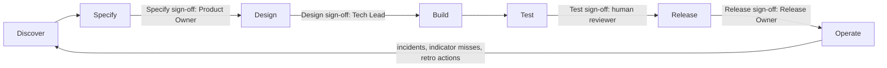

# Agentic SDLC — Reference Guide

The **Agentic SDLC** is a method that follows the standard software development life cycle with AI agents: **7 stages, 4 human sign-offs, 13 agents named by function and 3 paths sized by a scored rubric.** Agents execute; named humans approve. One rule ties the cycle together: **every requirement is proven**, from the spec to production.

This reference is **not needed before the first run**: start with [`references/quickstart.md`](../../skills/agentic-sdlc/references/quickstart.md) (one Quick-path bug fix end to end). Install the 20 skills with `npx claude-superskills --bundle agentic-sdlc -y`.

Normative rules live in `skills/agentic-sdlc/references/` (`lifecycle.md`, `rules.md`, `governance.md`, `paths.md`, `artifacts.md`); they win over this guide.

## 1. The cycle



| Stage | What happens | Lead agent (helpers on triggers) | Stage skills |
|---|---|---|---|
| **Discover** | Intake, duplicate search, classification, path score, indicator | Analyst (Product Manager) | `issue-triage`, `project-context`, `brainstorming` |
| **Specify** | `spec.md`: `AC-n` (Given/When/Then), non-goals, security notes, rollback, observability | Analyst (Product Manager, UX Designer, Security Auditor) | `spec-driven-development`, `grill-me` (+ `codebase-modernization` for brownfield, `security-hardening` for the threat model) |
| **Design** | ADRs; `plan.md` with vertical-slice tasks | Planner (Architect) | `senior-solution-architect`, `writing-plans` |
| **Build** | One task per fresh context, test-first, commits `Refs: Tn AC-n` | Developer (Tech Writer) | `executing-plans`, `test-driven-development`, `systematic-debugging` |
| **Test** | Acceptance tests from the spec, independent review, fresh evidence | Reviewer (Test Engineer, Security Auditor, UX Designer) | `test-strategy`, `verification-gate`, `multi-axis-code-review`, `security-hardening` |
| **Release** | CI gates, staged rollout, rehearsed rollback, release notes, runbook | Release Engineer (Tech Writer) | `deployment-pipeline`, `shipping-and-handover` |
| **Operate** | Watch alerts and indicator, incidents, postmortems, retro | SRE (Product Manager) | `operations-and-incidents`, `retrospective` |

Review is not a stage: it runs inside Test. Unit tests belong to Build; Test verifies the change against the spec. The router plays the **Scrum Master**: it detects state from `specs/` and git and prints the position at each transition.

## 2. Human sign-offs

| Sign-off | Closes | Default role | Recorded in | Bound to |
|---|---|---|---|---|
| **Specify sign-off** | Specify | Product Owner | `spec.md` → `## Approvals` | spec revision + 12-hex hash |
| **Design sign-off** | Design, before code | Tech Lead | `plan.md` → `## Approvals` | plan revision + hash + the spec hash it was built on |
| **Test sign-off** | Test | Human reviewer (engineer, not the PR author) | Pull request review | head commit SHA |
| **Release sign-off** | Before production | Release Owner | Release notes → `## Approval` | release tag + rehearsal output |

An **intake decision** by the Product Owner is also required when Discover finds a duplicate or a prior rejection; otherwise the issue records `n/a — <reason>`.

How approvals work:

- The agent presents the artifact, the evidence reviewed and the residual risks, asks for a decision and **ends its turn**. Only an explicit "yes" or "approved" in a later turn counts; silence or "whatever you think" does not.
- Each record holds revision, hash, date, role, person, exact words, evidence reviewed, residual risks and decision. Any later edit changes the hash, voids the approval and triggers the change protocol.
- `spec-lint --check-approval` and `plan-graph --check-approval` verify the hashes before Build and in CI. Branch protection, CODEOWNERS on `specs/**` and a `production` environment with required reviewers enforce the Test and Release sign-offs (`deployment-pipeline`). A host without these controls marks every PR `enforcement: prompt-only`; the approvals still apply.
- One person can hold several roles; the record names the role exercised. Passing a failed gate needs a waiver: owner ≠ requester, reason, expiry ≤ 30 days, follow-up issue. RACI: `references/governance.md`.

## 3. The 13 agents

Agents are functional briefs, not personas, for context isolation, least privilege and separation of duties: the agent that builds never tests, reviews or approves its own work. Each brief in `skills/agentic-sdlc/agents/` lists what the agent reads and never sees, its skills, allowed and forbidden actions, tools and report.

| Agent | Kind | Stages | Returns |
|---|---|---|---|
| **Scrum Master** | Core, played by the router | All | Progress line, impediment log, escalations, retro draft |
| **Analyst** | Core | Discover, Specify | Path score, intake record, `spec.md` |
| **Product Manager** | Specialist | Discover, Specify (critique), Operate (indicator) | Brief: problem, outcome, indicator, priority |
| **UX Designer** | Specialist | Specify, Design (consulted), Test | `ux.md`: journeys, state table, accessibility |
| **Planner** | Core | Design | `plan.md`, `graph.json` |
| **Architect** | Specialist | Design; loop escalations | ADRs, interface notes, design rulings |
| **Developer** | Core | Build, one per task | Task report, commits, evidence |
| **Test Engineer** | Specialist | After Design sign-off → Test | Acceptance tests mapped `AC-n` → test |
| **Reviewer** | Core, read-only | Test | GO / NO-GO verdict, triage log |
| **Security Auditor** | Specialist | Specify, Test | Threat model, security findings |
| **Tech Writer** | Specialist | Build (docs task), Release | Docs diff, user section of release notes |
| **Release Engineer** | Specialist | Release | Release checklist, go/no-go brief |
| **SRE** | Specialist | Operate | Ops record, incident record, retro facts |

Specialists join only when their trigger fires, so a Quick bug fix uses four roles: Scrum Master, Analyst, Developer and Reviewer. On a platform without subagents, each agent runs as a separate labelled pass, and every check of the author's own work is labelled `self-review` in the PR.

**Report contract.** Every report ends with a status — `DONE`, `DONE_WITH_CONCERNS`, `BLOCKED`, `NEEDS_CONTEXT` or `CANNOT_VERIFY` — and evidence. Severities: **Critical** (blocks the Test and Release sign-offs), **Important** (fix or accept as residual risk), **Minor** (deferred).

**Bounded loops.** Red-green 3 attempts → debug loop; build-test 5 rounds per task; review-fix 3 rounds; debug 3 refuted hypotheses → Architect. At a bound the run stops and escalates; nobody weakens a test or check to get green.

## 4. Paths

Every item gets a score in Discover:

- **Size S** = files (≤ 3: 1 · 4–15: 2 · > 15: 3) + components (1 / 2 / ≥ 3 → 1 / 2 / 3) + iterations (1 / 2 / ≥ 3 → 1 / 2 / 3).
- **Risk R** = count of triggers: auth, personal/health data, money, public API, schema/migration, irreversible, regulated.
- **Path = the higher of the size route and the risk route.**

| Path | Route | Sign-offs | Required artifacts |
|---|---|---|---|
| **Quick** | S ≤ 4 and R = 0 | Test (+ Release when production deploys) | Issue with acceptance test, PR with Verification, batched retro |
| **Standard** | S 5–6 or R = 1 | Specify + Design (one combined review when the plan has ≤ 5 tasks), Test, Release | `spec.md`, `plan.md`, `acceptance-tests.md`, PR, release notes, retro |
| **Full** | S ≥ 7, R ≥ 2, personal/health data or irreversible | All four separately + a second human reviewer on the Test sign-off | Standard set + ADRs, threat model, `CONSTRAINTS.md`, runbook, full retro |

Missing inputs → Standard. During Build, exceeding the file bound (Quick > 3, Standard > 15) or a new trigger forces a re-score; paths never route down silently. Examples: `references/paths.md`.

## 5. Artifacts

```
<project>/
├── AGENTS.md / CLAUDE.md      # AGENTIC-SDLC block with the sdlc-dod Definition of Done
├── CONSTRAINTS.md             # Full path only
├── docs/adr/  docs/runbooks/  docs/postmortems/  docs/retros/  docs/codemap.md
└── specs/NNN-slug/            # one folder per Standard or Full item
    ├── spec.md  ux.md  threat-model.md  approvals.md
    ├── plan.md  graph.json  acceptance-tests.md
    └── run-ledger.jsonl  handoff.md  ops.md
PR body                        # Verification (AC-n → test → fingerprint-bound evidence), Trace, Review triage
```

The ID chain makes "every requirement is proven" checkable: `AC-n` in the spec → task `Tn` in the plan → commit trailer `Refs: Tn AC-n` → test name → PR Verification row → release notes → ops record. Gap analysis runs both ways before the Test sign-off: every AC has a passing test, and every task and commit traces to an AC.

Quick items create no `specs/` folder: the issue holds the acceptance test, the PR the evidence. Templates: `skills/agentic-sdlc/templates/`; index: `references/artifacts.md`.

**Scripts.** `spec-lint`, `plan-graph`, `preflight`, `run-ledger` and `budget-check` are dependency-free Node ≥ 18 modules (exit `0` pass · `1` fail · `2` input missing · `3` bound reached), vendored by `project-context`. Without Node, the checks run by hand.

## 6. Worked example

[`skills/agentic-sdlc/examples/worked-example/`](../../skills/agentic-sdlc/examples/worked-example/) takes one feature through all seven stages on the Standard path: a CSV export of filtered order rows (`Path: Standard · S=5 · R=1 (money)`). It holds every artifact from spec to retro and is the scripts' test fixture:

```bash
cd skills/agentic-sdlc
node scripts/spec-lint.mjs examples/worked-example/specs/001-csv-export/spec.md --check-approval
node scripts/plan-graph.mjs examples/worked-example/specs/001-csv-export/plan.md --check --check-approval
```

Team rollout (Quick, then Standard, then CI gates) and Scrum/Kanban mapping: `references/adoption.md`.

## Appendix A — Standards mapping

These tables show where the method produces work products related to each standard. **They are not compliance or conformity claims**; the organization's compliance owner decides after examining the evidence. Standards are named by clause or practice ID only.

### A.1 ISO/IEC/IEEE 12207:2017 — software life cycle processes

| 12207 process | Agentic SDLC stage | Main evidence |
|---|---|---|
| 6.4.1 Business or mission analysis · 6.4.2 Stakeholder needs and requirements definition | Discover | Intake record, Product Manager brief, indicator |
| 6.4.3 System/software requirements definition | Specify | `spec.md` with `AC-n`, NFRs, Specify sign-off |
| 6.4.4 Architecture definition · 6.4.5 Design definition | Design | ADRs, `plan.md`, Design sign-off |
| 6.4.7 Implementation · 6.4.8 Integration | Build | Test-first commits `Refs: Tn AC-n`, run ledger |
| 6.4.9 Verification · 6.4.11 Validation | Test | PR Verification and Trace, acceptance tests, Test sign-off |
| 6.4.10 Transition | Release | Release notes, rollback rehearsal, Release sign-off |
| 6.4.12 Operation · 6.4.13 Maintenance | Operate | Ops record, incidents, postmortems |
| 6.3.3 Decision management · 6.3.4 Risk management | Design, Specify | ADRs; path score, threat model, residual risks |
| 6.3.5 Configuration management | All | Git history, approval hashes, tags |
| 6.3.7 Measurement · 6.3.8 Quality assurance | Operate, Test | Indicator readings, retro metrics, independent review |

### A.2 IEC 62304 — medical device software life cycle processes

| IEC 62304 clause | Agentic SDLC stage | Main evidence |
|---|---|---|
| 5.1 Software development planning | Discover, Design | AGENTS.md block, path score, `plan.md` |
| 5.2 Software requirements analysis | Specify | `spec.md`, threat model, Specify sign-off |
| 5.3 Software architectural design · 5.4 Software detailed design | Design | ADRs, interface notes, `plan.md` |
| 5.5 Software unit implementation and verification | Build | Test-first commits, unit tests |
| 5.6 Software integration and integration testing · 5.7 Software system testing | Build, Test | Acceptance tests, PR Verification |
| 5.8 Software release | Release | Release notes with residual risks, Release sign-off |
| 6 Software maintenance · 9 Software problem resolution | Operate → Discover | `from-production` issues, postmortems |
| 7 Software risk management | Specify, Test | Threat model, security review, residual risks |
| 8 Software configuration management | All | Git, dependency notes, approval hashes |

**Safety classes.** IEC 62304 scales activities by software safety class (A, B, C). Work on medical device software sets the `regulated` risk trigger, so it never runs on the Quick path; health data or a second trigger routes it to Full. A reasonable default is the Full path for Class B and C work, whose ADRs and design notes give a place for the detailed design Class C asks for. The manufacturer's software development plan decides.

### A.3 NIST SP 800-218 — Secure Software Development Framework (SSDF)

| SSDF practices | Agentic SDLC stage | Main evidence |
|---|---|---|
| PO.1–PO.5 Prepare the organization | Discover, Specify, Build | Security notes, named sign-off owners, `sdlc-dod` toolchain, CI security gate |
| PS.1–PS.3 Protect the software | Build, Release | Branch protection, CODEOWNERS, tagged releases, per-change records in git |
| PW.1–PW.2 Design to meet security requirements | Specify, Design | Threat model, abuse cases as negative AC, Security Auditor pass |
| PW.4–PW.9 Produce well-secured software | Build, Test, Release | Dependency notes, hardening checks, independent security review, secure defaults |
| RV.1–RV.3 Respond to vulnerabilities | Operate, Discover | Dependency audits, waivers with expiry, postmortems |

The practice-level table with coverage and gaps is `skills/security-hardening/references/ssdf-mapping.md`.

## Appendix B — Coming from Spec Kit, Kiro, AI-DLC or BMad

Existing folders are mapped in place; a parallel `specs/` tree is never created.

| Coming from | Existing files map to | What is new | First step |
|---|---|---|---|
| **GitHub Spec Kit** | `specs/NNN-feature/spec.md`, `plan.md`, `tasks.md` stay; `tasks.md` rows become the `## Tasks` table of `plan.md`, or `plan.md` links to them | Sign-offs bound to file hashes, bounded loops, acceptance tests designed in a separate context, Release and Operate stages | Add `## Approvals` to the current spec and run `spec-lint` |
| **Kiro** | `.kiro/specs/<feature>/requirements.md` = spec; `design.md` + `tasks.md` = plan | Path sizing (Quick skips the spec file), review axes, evidence bound to the working tree | Number the requirements `AC-n` (each restated as Given/When/Then); run one bug on the Quick path |
| **AWS AI-DLC** | Each unit of work = one `specs/NNN-slug/` item; inception requirements = spec; construction plan = plan | Agent briefs with "never sees" rules, Quick path for small work, the scored path rubric | Score the next item with `references/paths.md` before inception |
| **BMad Method** | PRD sections → one spec per capability; architecture → ADRs + `plan.md` design notes; one story = one plan task or one Quick item | Functional agent names, 4 hash-bound sign-offs, acceptance tests designed before Build, Scrum Master played by the router | Turn the current story into a Quick or Standard item and let the Analyst score it |

OpenSpec, Superpowers and teams without a method: `references/adoption.md` §3–§4.

## Credits

Adapts mechanisms from Superpowers, Matt Pocock's skills, Addy Osmani's agent-skills and the BMad Method (all MIT); maps artifacts to GitHub Spec Kit, AWS AI-DLC, OpenSpec and Kiro conventions (ideas only). All text is original. See [`THIRD_PARTY_NOTICES.md`](../../THIRD_PARTY_NOTICES.md) and each README's `## Influences`.
