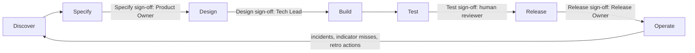

# Claude Superskills: installation and skills library

Installer, platforms, bundles and the full skill catalog. The project overview is in the [root README](../README.md).

> Research, content and document skills (deep-research, webpage-reader, youtube-summarizer, pptx-translator, document-converter, storytelling-expert and others) moved to [knowledge-superskills](https://github.com/ericgandrade/knowledge-superskills).

> From v3.0.0, `npx agentic-sdlc-method` and the install script ship the Agentic SDLC from `main`.

## 🚀 Quick Install

**One-liner (recommended):**
```bash
curl -fsSL https://raw.githubusercontent.com/ericgandrade/agentic-sdlc/main/scripts/install.sh | bash
```

**Or use NPX (zero-install):**
```bash
npx agentic-sdlc-method
```

The installer always uses **global installation** (`~/.<platform>/skills`), compares installed skill versions with the current installer version, shows differences, and recommends updates/new installs automatically.

**Other methods:**
```bash
# npm global
npm install -g agentic-sdlc-method

# With bundles
npx agentic-sdlc-method --bundle essential -y
npx agentic-sdlc-method --bundle agentic-sdlc -y
```

**Local install (no npm/npx required):**

If you have cloned the repository and want to install skills directly, without any internet download or Node.js:
```bash
git clone https://github.com/ericgandrade/agentic-sdlc
cd agentic-sdlc

# Interactive — choose which platforms to install to
./scripts/local-install.sh

# Auto-install to all detected platforms
./scripts/local-install.sh -y

# Silent auto-install (CI / scripted environments)
./scripts/local-install.sh -y -q
```

The script reads directly from `skills/`, detects your installed platforms, and copies everything into the right directories. No Node.js, no npm, no internet.

See [Installation Guide](INSTALLATION.md) for all methods and troubleshooting.

**Uninstall:**
```bash
curl -fsSL https://raw.githubusercontent.com/ericgandrade/agentic-sdlc/main/scripts/uninstall.sh | bash
```

## 🔁 Agentic SDLC

The **Agentic SDLC** follows the standard software development life cycle with AI agents: **7 stages, 4 human sign-offs, 13 agents named by function and 3 paths (Quick, Standard, Full) chosen by a path score.** Agents execute; named humans approve. One rule ties the cycle together: every requirement is proven, from the spec to production.



| Stage | Lead agent | Skills | Human sign-off |
|-------|------------|--------|----------------|
| **Discover** | Analyst | `issue-triage`, `project-context`, `brainstorming` | — |
| **Specify** | Analyst | `spec-driven-development`, `grill-me` (+ `codebase-modernization` for brownfield, `security-hardening` for the threat model) | Product Owner |
| **Design** | Planner | `senior-solution-architect`, `writing-plans` | Tech Lead |
| **Build** | Developer | `executing-plans`, `test-driven-development`, `systematic-debugging` | — |
| **Test** | Reviewer | `test-strategy`, `verification-gate`, `multi-axis-code-review`, `security-hardening` | human reviewer |
| **Release** | Release Engineer | `deployment-pipeline`, `shipping-and-handover` | Release Owner |
| **Operate** | SRE | `operations-and-incidents`, `retrospective` | — |

The router skill `agentic-sdlc` plays the **Scrum Master**: it reads the repository state, picks the path and hands each stage to the right agent and skill. The 13 agents are Scrum Master, Analyst, Product Manager, UX Designer, Planner, Architect, Developer, Test Engineer, Reviewer, Security Auditor, Tech Writer, Release Engineer and SRE. Every agent report ends with one status (`DONE`, `DONE_WITH_CONCERNS`, `BLOCKED`, `NEEDS_CONTEXT`, `CANNOT_VERIFY`), and every fix loop is bounded.

```bash
# Install the 20 Agentic SDLC skills
npx agentic-sdlc-method --bundle agentic-sdlc -y
```

Then ask your agent: *"Use agentic-sdlc to fix issue #42"*. First run: [Quickstart](../skills/agentic-sdlc/references/quickstart.md) (one Quick-path bug fix end to end). Reference: [Agentic SDLC Guide](guides/agentic-sdlc.md) (stages, sign-offs, agents, paths, artifacts, standards mapping, coming from Spec Kit / Kiro / AI-DLC / BMad). Worked example: [`skills/agentic-sdlc/examples/worked-example/`](../skills/agentic-sdlc/examples/worked-example/).

## 🔌 Claude Code Plugin (Native)

Use The Agentic SDLC Method as a native Claude Code plugin — no npm, no Node.js required.
Requires **Claude Code v1.0.33+** (`claude --version` to check).

---

### Option A — Claude Code CLI (Terminal)

> ⚠️ **Important:** While the universal installer (`npx agentic-sdlc-method`) works perfectly to copy skills into `~/.claude/skills/`, using the native Claude Code Plugin system (described below) is the **recommended and most suitable installation method** for Claude Code users.

**Method 1: Interactive UI (Inside a running `claude` session) — Recommended**

Start a Claude Code session:
```bash
claude
```

Then run these slash commands inside the session:
```text
# 1. Add the marketplace
/plugin marketplace add ericgandrade/agentic-sdlc

# 2. Install the plugin
/plugin install agentic-sdlc@agentic-sdlc
```

Alternatively, open the plugin manager with `/plugin` → navigate to the **Discover** tab → search for "agentic-sdlc" → press **Enter** → choose your preferred scope.

**Method 2: Shell command (Outside a session)**

> 🐛 **Known Bug:** The `claude plugin install` shell command is currently **failing** due to an upstream issue in Claude Code. We strongly recommend using the interactive in-session method above. If you prefer a CLI approach, the universal installer (`npx agentic-sdlc-method`) is completely reliable and stable. Tracked at: [anthropics/claude-code#29722](https://github.com/anthropics/claude-code/issues/29722).

```bash
# Attempt to add marketplace + install in one flow (Currently unstable)
claude plugin install agentic-sdlc@agentic-sdlc
```

Choose your scope with `--scope`:

```bash
claude plugin install agentic-sdlc@agentic-sdlc --scope user     # all your projects (default)
claude plugin install agentic-sdlc@agentic-sdlc --scope project  # team-shared via .claude/settings.json
claude plugin install agentic-sdlc@agentic-sdlc --scope local    # this project only, gitignored
```

**Method 3: Local test (no install needed)**

```bash
git clone https://github.com/ericgandrade/agentic-sdlc
claude --plugin-dir ./agentic-sdlc
```

---

### Option B — Claude.ai Web (claude.ai)

Plugin installation on claude.ai requires the plugin to be listed in the **official Anthropic marketplace**. Submission is pending. Once approved, you will be able to install directly from:

> **Settings → Extensions → Browse Plugins** on [claude.ai](https://claude.ai)

To be notified when the plugin is available on claude.ai, watch this repository.

---

### Option C — Claude Desktop Cowork (Custom Plugin Upload)

If you use Claude Desktop with Cowork, the safest path is to generate a plugin zip locally and upload it manually in Cowork. This path does not depend on the `claude plugin install` shell flow.

Generate the package with the installer:

```bash
npx agentic-sdlc-method package-cowork
```

Or let the interactive installer detect Cowork and offer it as a packaging target:

```bash
npx agentic-sdlc-method
```

The installer will generate a zip like:

```text
~/.claude-superskills/plugin-output/claude-superskills-v2.0.3.zip
```

Then update Cowork manually:

1. Open Claude Desktop.
2. Switch to `Cowork`.
3. Open `Customize`.
4. Find the existing `agentic-sdlc` plugin.
5. Remove the previous version first.
6. Upload the new zip generated by the installer.
7. Confirm the new version appears in Cowork.

Important:
- The historical `claude plugin install` bug affects the GitHub/CLI install flow, not the Cowork custom zip upload flow.
- Cowork is treated as `package + manual upload`, not as an auto-installed `~/.claude/skills/` target.
- Current support level: validated on macOS; Windows and Linux detection are implemented as best-effort heuristics and should be treated as not yet fully validated in real Cowork environments.

---

### Once installed — all 23 skills under the `agentic-sdlc:` namespace

```
/agentic-sdlc:agentic-sdlc
/agentic-sdlc:issue-triage
/agentic-sdlc:project-context
/agentic-sdlc:brainstorming
/agentic-sdlc:spec-driven-development
/agentic-sdlc:grill-me
/agentic-sdlc:codebase-modernization
/agentic-sdlc:security-hardening
/agentic-sdlc:senior-solution-architect
/agentic-sdlc:writing-plans
/agentic-sdlc:executing-plans
/agentic-sdlc:test-driven-development
/agentic-sdlc:systematic-debugging
/agentic-sdlc:test-strategy
/agentic-sdlc:verification-gate
/agentic-sdlc:multi-axis-code-review
/agentic-sdlc:deployment-pipeline
/agentic-sdlc:shipping-and-handover
/agentic-sdlc:operations-and-incidents
/agentic-sdlc:retrospective
/agentic-sdlc:skill-creator
/agentic-sdlc:agent-skill-discovery
/agentic-sdlc:agent-skill-orchestrator
```

> **npm install still works** for GitHub Copilot, Cursor IDE, Gemini CLI, and 5 other platforms. The plugin format is Claude Code-specific.

## ✨ Features

- **23 Universal Skills** - Work on all platforms
- **Agentic SDLC** - 20-skill method from Discover to Operate with human sign-offs, bounded loops and evidence-based verification
- **Zero-Config Install** - Run once, works everywhere
- **Curated Bundles** - Install exactly what you need
- **Smart Search** - Find skills by keyword
- **8 Platform Support** - GitHub Copilot, Claude Code, Codex, OpenCode, Gemini, Antigravity, Cursor, AdaL
- **Discovery & Orchestration** - Find and plan with available resources
- **Command Shortcuts** - `i`, `ls`, `up`, `rm`, `doc`
- **Short Flags** - `-a`, `-y`, `-q`

## 📦 Available Skills

### 🔁 Agentic SDLC
| Skill | Version | Stage | Purpose |
|-------|---------|-------|---------|
| **agentic-sdlc** | v2.2.0 | Router | Scrum Master router: detects state, scores the path (Quick, Standard, Full), hands each stage to its agent and skills, enforces the 4 human sign-offs |
| **issue-triage** | v1.0.0 | Discover | Turns an incoming item into a decision-ready intake record: duplicate search, classification, path score, indicator |
| **project-context** | v1.3.0 | Discover | Verified starting context for every agent session: commands, `sdlc-dod` Definition of Done, code map, conventions, pitfalls |
| **brainstorming** | v3.1.0 | Discover | Pre-implementation design clarification before any spec or code |
| **spec-driven-development** | v2.1.0 | Specify | Writes `specs/NNN-slug/spec.md` with numbered acceptance criteria, non-goals, security notes, rollback and indicator |
| **grill-me** | v2.2.0 | Specify | Relentless Socratic interview to stress-test a spec, plan or design |
| **codebase-modernization** | v1.0.0 | Specify, Design | Brownfield work: inventory, dependency map, characterization tests and safe migration slices |
| **security-hardening** | v1.0.0 | Specify, Test | Data classification, STRIDE threat model, secure-build guidance and security review |
| **senior-solution-architect** | v2.3.0 | Design | C4 modeling, ADRs and system reviews |
| **writing-plans** | v3.2.0 | Design | `plan.md` task graph of vertical slices with dependencies and files, validated by `plan-graph` |
| **executing-plans** | v4.0.1 | Build | Executes plan tasks one per fresh context, test-first, with per-task review and a run ledger |
| **test-driven-development** | v1.0.0 | Build | Red-green-refactor under the iron law: no production code before a failing test |
| **systematic-debugging** | v1.0.0 | Build | Proven root cause inside a bounded debug loop of falsifiable hypotheses |
| **test-strategy** | v1.0.0 | Test | Acceptance tests designed from the spec by a context that never saw the implementation |
| **verification-gate** | v1.0.0 | Test | Turns completion claims into fresh, fingerprinted evidence |
| **multi-axis-code-review** | v1.0.0 | Test | Independent review on five axes through four fresh-context lenses, with Critical/Important/Minor triage |
| **deployment-pipeline** | v1.0.0 | Release | Makes CI enforce the Definition of Done and approval checks; staged rollout and rehearsed rollback |
| **shipping-and-handover** | v1.0.0 | Release | Pre-ship checklist, PR body with evidence, release notes and runbook handover |
| **operations-and-incidents** | v1.0.0 | Operate | Ops record, SLIs and SLOs from the spec, release watch, incidents and postmortems |
| **retrospective** | v1.0.0 | Operate | Evidence-based retro record with owned actions; feeds new work back to Discover |

### 🔍 Discovery & Orchestration
| Skill | Version | Purpose |
|-------|---------|---------|
| **agent-skill-discovery** | v2.1.0 | Scan installed resources and current repository resources (agents, skills, MCPs) |
| **agent-skill-orchestrator** | v2.2.0 | Intelligent task planning with resource matching; proposes the Agentic SDLC router for software-delivery requests |

### 🛠️ Development & Automation
| Skill | Version | Purpose |
|-------|---------|---------|
| **skill-creator** | v2.1.0 | Automate skill creation with guided workflow |


## 🎯 Curated Bundles

```bash
# Essential Skills (recommended for beginners)
npx agentic-sdlc-method --bundle essential -y

# Agentic SDLC (router + 19 stage skills, Discover → Operate)
npx agentic-sdlc-method --bundle agentic-sdlc -y

# Planning & Execution
npx agentic-sdlc-method --bundle planning -y

# Discovery & Orchestration
npx agentic-sdlc-method --bundle orchestration -y

# All Skills (complete collection)
npx agentic-sdlc-method --bundle all -y
```

See [Bundles Guide](bundles/bundles.md) for details.

## 🔍 Search Skills

```bash
npx agentic-sdlc-method --search "plan"
npx agentic-sdlc-method --search "review"
```

## 🚀 Quick Start Examples

### Discovery & Planning Workflow

```bash
# 1. Discover what's available
claude  # or: gh copilot, gemini, opencode, codex
> "What do I have installed?"

# Output: Lists installed and current-repository plugins, skills, MCPs

# 2. Get intelligent execution plan
> "Plan how to build a REST API with authentication"

# Output: Detailed strategy using best available resources with confidence scores
```

### Agentic SDLC Workflow

```bash
claude  # or: gh copilot, gemini, opencode, codex, cursor
> "Use agentic-sdlc to fix issue #42"

# The router scores the path, runs Discover → Specify → Design → Build → Test,
# stops at each human sign-off and proves every acceptance criterion with fresh evidence
```

### Other Use Cases

```bash
# Create a new skill
gh copilot -p "create a skill for PDF processing"

# Review a change
claude -p "review this branch on all five axes"

# Orchestrate complex tasks
gemini -p "design a solution for processing meeting notes and creating Jira tickets"
```

## 💻 Supported Platforms

- **GitHub Copilot CLI** - Terminal AI assistant (`~/.copilot/skills/`)
- **Claude Code** - Anthropic's Claude in development (`~/.claude/skills/`)
- **OpenAI Codex** - GPT-powered coding assistant (`~/.codex/skills/`)
- **OpenCode** - Open source AI coding assistant (`~/.agent/skills/`)
- **Gemini CLI** - Google's Gemini in terminal (`~/.gemini/skills/`)
- **Antigravity** - AI coding assistant (`~/.gemini/antigravity/skills/`)
- **Cursor IDE** - AI-powered code editor (`~/.cursor/skills/`)
- **AdaL CLI** - AI development assistant (`~/.adal/skills/`)

**Note on Codex:** The installer uses `~/.codex/skills/` for Codex CLI + App, with cleanup support for legacy `~/.agents/skills/`.

## ⌨️ Compatibility & Invocation

These skills follow the universal `SKILL.md` format and work with any AI coding assistant that supports agentic skills.

| Tool | Type | Invocation Example | Path |
|------|------|--------------------|------|
| **Claude Code** | CLI | `/skill-name help me...` | `~/.claude/skills/` |
| **Gemini CLI** | CLI | `Use skill-name to...` | `~/.gemini/skills/` |
| **Codex CLI** | CLI | `Use skill-name to...` | `~/.codex/skills/` |
| **Antigravity** | IDE | *(Agent Mode)* `Use skill...` | `~/.gemini/antigravity/skills/` |
| **Cursor** | IDE | `@skill-name` in Chat | `~/.cursor/skills/` |
| **Copilot** | Ext | *(Paste skill content manually)* | N/A |
| **OpenCode** | CLI | `opencode run @skill-name` | `~/.agent/skills/` |
| **AdaL CLI** | CLI | *(Auto)* Skills load on-demand | `~/.adal/skills/` |

> **Tip:** OpenCode uses `~/.agent/skills/`; Antigravity uses `~/.gemini/antigravity/skills/`.

## 📚 Documentation

- **[Getting Started](guides/getting-started.md)** - First-time user guide
- **[Agentic SDLC Guide](guides/agentic-sdlc.md)** - Stages, sign-offs, agents, paths, artifacts, standards mapping
- **[Skill Anatomy](guides/skill-anatomy.md)** - How skills work
- **[Bundles Guide](bundles/bundles.md)** - Curated collections
- **[Quality Standards](guides/quality-standards.md)** - Best practices
- **[Full Catalog](../CATALOG.md)** - Complete skill listing

## ⚡ CLI Commands & Shortcuts

| Command | Shortcut | Purpose |
|---------|----------|---------|
| `install` | `i` | Install skills |
| `list` | `ls` | List installed skills |
| `status` | `st` | Show global install status + version differences |
| `update` | `up` | Smart update (outdated + missing skills) |
| `uninstall` | `rm` | Remove skills |
| `doctor` | `doc` | Check installation |

```bash
npx agentic-sdlc-method i -a -y -q    # Install all, skip prompts, quiet mode
npx agentic-sdlc-method status         # Show global status + skill version differences
npx agentic-sdlc-method up -y          # Update outdated + install missing skills
npx agentic-sdlc-method ls -q          # List with minimal output
npx agentic-sdlc-method --list-bundles # Show available bundles
```

## 📋 System Requirements

- Node.js 14+ (for installer)
- One or more supported platforms installed
- Python 3.8+ (for some skills with dependencies)

## 🤝 Contributing

We welcome contributions! Check [CONTRIBUTING.md](../CONTRIBUTING.md) for guidelines.

- Create new skills using the [skill-creator](https://github.com/ericgandrade/agentic-sdlc) skill
- Follow [Quality Standards](guides/quality-standards.md)
- Report issues and suggestions

## 🔒 Privacy

The Agentic SDLC Method does not collect, store, transmit, or share any user data.

- **No external servers** — the plugin has no backend, no telemetry, and no network requests of its own
- **No API keys required** — all skills run entirely within Claude Code using Claude's native tools (WebSearch, WebFetch, Bash, Read/Write)
- **No logging** — nothing is recorded outside of your local Claude Code session
- **Open source** — all skill logic is fully auditable at [github.com/ericgandrade/agentic-sdlc](https://github.com/ericgandrade/agentic-sdlc)

Any web searches or document fetches performed by skills use Claude Code's built-in tools, subject to Anthropic's own privacy policy.

## 📄 License

MIT - See [LICENSE](../LICENSE) for details.

## 🔗 Quick Links

- 📚 [Full Catalog](../CATALOG.md) - All skills with metadata
- 🛠️ [Skills Development Guide](../resources/skills-development.md) - Create custom skills
- 📝 [Changelog](../CHANGELOG.md) - Release history
- 🐛 [Issues](https://github.com/ericgandrade/agentic-sdlc/issues) - Report problems
- 💬 [Discussions](https://github.com/ericgandrade/agentic-sdlc/discussions) - Share ideas

---

**Built with ❤️ by [Eric Andrade](https://github.com/ericgandrade)**


## 🎁 Get Started

Choose a bundle that fits your workflow:

- **[Essential](bundles/bundles.md#essential)** - agentic-sdlc, skill-creator, agent-skill-discovery, agent-skill-orchestrator, brainstorming, writing-plans, executing-plans, grill-me
- **[Agentic SDLC](bundles/bundles.md#agentic-sdlc)** - router + 19 stage skills, Discover → Operate
- **[Planning](bundles/bundles.md#planning)** - brainstorming, spec-driven-development, project-context, writing-plans, executing-plans, grill-me, agent-skill-orchestrator
- **[Orchestration](bundles/bundles.md#orchestration)** - agent-skill-discovery, agent-skill-orchestrator
- **[All](bundles/bundles.md#all)** - Complete 23-skill toolkit

See [detailed comparison](bundles/bundles.md#bundle-comparison).

## 🛠️ Advanced Usage

- **[Skill Anatomy](guides/skill-anatomy.md)** - How to build skills
- **[Skills Development](../resources/skills-development.md)** - Advanced creation
- **[Changelog](../CHANGELOG.md)** - Version history

## Part of the Superskills Family

| Package | Skills | Focus | Install |
|---------|--------|-------|---------|
| **agentic-sdlc** | 23 | Core: Agentic SDLC, skill creation, discovery & orchestration | `npx agentic-sdlc-method` |
| [knowledge-superskills](https://github.com/ericgandrade/knowledge-superskills) | 10 | Research, content, documents, strategy & prompts | Claude Code plugin (no npm package yet) |
| [obsidian-superskills](https://github.com/ericgandrade/obsidian-superskills) | 6 | Obsidian knowledge management | `npx obsidian-superskills` |
| [career-superskills](https://github.com/ericgandrade/career-superskills) | 20 | Job search & career development | `npx career-superskills` |
| [product-superskills](https://github.com/ericgandrade/product-superskills) | 8 | Product management & GTM strategy | `npx product-superskills` |
| [design-superskills](https://github.com/ericgandrade/design-superskills) | 9 | UI/UX design, brand & diagrams | `npx design-superskills` |
| [avanade-superskills](https://github.com/ericgandrade/avanade-superskills) | 3 | Avanade-branded content (private) | `git clone git@github.com:ericgandrade/avanade-superskills.git` |

---

**Getting Started? Check [Quick Start](guides/getting-started.md) or run `npx agentic-sdlc-method` now!**
