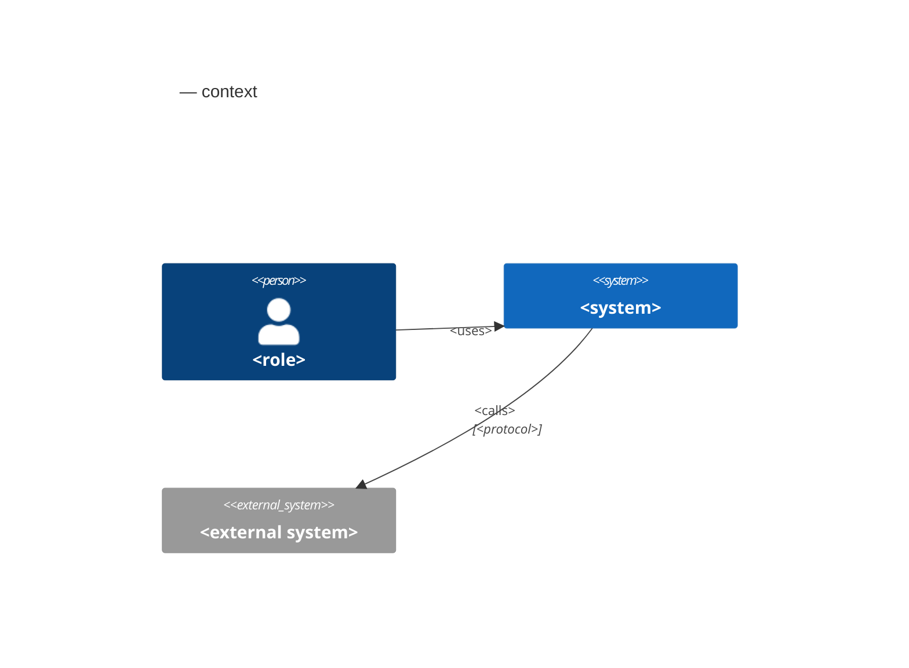
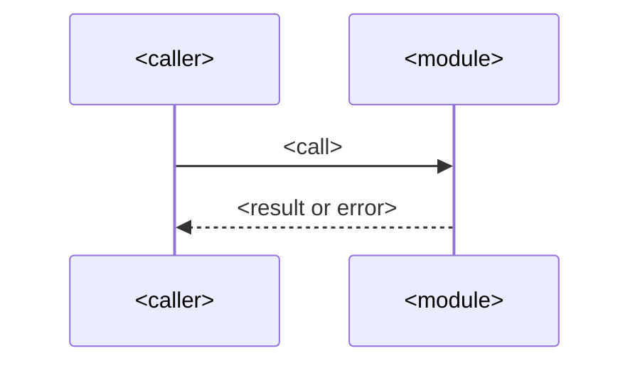

# Architecture notes — <scope>

<!--
Template from the senior-solution-architect skill (Workflow Step 5). Fill every section; a section with
nothing to record holds one line: `none — <reason>`.

Where it lives:
- Standalone work: `docs/architecture/<kebab-slug>.md`, or the project's existing architecture folder.
- Agentic SDLC Design stage: the Architect edits only `docs/adr/**` and the design sections of plan.md
  (../../agentic-sdlc/agents/architect.md §Tools). Use these notes as the working draft returned in the
  Architect report ("interface notes"), then distill them using the table at the end. Do not commit a
  separate architecture file unless the project already keeps one and the plan lists it in a task's Files.

Vocabulary: module, interface, implementation, depth, seam, adapter, leverage, locality
(references/deep-modules.md §1). C4 diagrams keep C4's own words.
Unverified facts carry [ASSUMPTION: …] until confirmed; each one is listed again in §12.
-->

- **Mode:** standalone | Design stage (`specs/NNN-slug/spec.md` rev N, hash `<12 hex>`)
- **Path:** Standard | Full · **Code map:** `docs/codemap.md` verified YYYY-MM-DD at `<sha>` | absent — <reason>
- **AC served:** AC-1, AC-2, … | n/a (standalone)
- **Author:** Architect · YYYY-MM-DD

## 1. Problem frame

<!-- 5–15 lines. Forces with numbers: volume, latency (p95), availability, data classes, team size, deadline, CONSTRAINTS.md IDs. -->

| Force | Value | Source |
|---|---|---|
| <e.g. max rows per export> | <50,000> | <AC-4> |

## 2. Invariants

<!--
Only decisions where two modules built independently could choose incompatibly, AND the call is
non-obvious, AND it is a real trade-off. Everything else goes under Deferred. IDs I-n ascend and are
never reused. An invariant that meets the ADR trigger also gets an ADR (§11).
-->

### I-1 — <decision in one line>

- **Binds:** <AC-n, modules from the code map, or `all`>
- **Prevents:** <the divergence it stops>
- **Rule:** <enforceable statement a reviewer can check in a diff>

### Deferred

- <decision> — <why it can wait> — <revisit trigger>

## 3. Designs compared

<!-- From references/design-it-twice.md §5. One line per design and the recommendation; the full table goes in the ADR. -->

| Design | Constraint | Verdict |
|---|---|---|
| A | C1 minimize interface | chosen — <two reasons> |
| B | C5 do less | rejected because <reason> |

## 4. Modules and interfaces

| Module (code map name) | Hides | Interface (entry points) | Depth | Dependency category | Adapters |
|---|---|---|---|---|---|
| <module> | <decision likely to change> | `<signature>` | deep / medium / shallow | in-process / local-substitutable / remote-owned / external | <none / prod + test> |

## 5. Diagrams

<!-- C4 Level 1 and 2 whenever the change adds or alters a system, container or external actor. Level 3 only for the module being designed. One sequence diagram for the main flow when ≥ 3 modules interact. If a diagram needs a paragraph to be understood, redraw it. -->

## 6. Data model and ownership

| Entity or store | Owner module | Data class | Change (new / additive / breaking) | Migration pattern |
|---|---|---|---|---|
| <table, topic, file> | <module> | Public / Internal / Financial / Personal / Sensitive personal | additive | none / expand → migrate → contract |

## 7. Contracts

<!-- One row per public or cross-service interface; answers from references/interface-checklist.md. -->

| Interface | Checklist items open | Breaking? | Callers (code map dependents) |
|---|---|---|---|
| `<GET /path>` | none | no | <modules> |

## 8. Security boundary

- **Trust boundaries crossed:** <TB-n from threat-model.md, or the new boundary>
- **New or changed data flows:** <DF-n> → threat model covers it: yes | no → Security Auditor revision before Design sign-off
- **Threat model:** `specs/NNN-slug/threat-model.md` rev N | n/a — <reason>
- **Controls that become tasks:** <control → task or AC>

## 9. Operational envelope

<!-- The dimension most often left silent. Answer each line. -->

- **Deployables added or changed:** <none / list>
- **Scaling and limits:** <numbers>
- **Failure modes and degradation:** <what happens when each dependency is down>
- **Observability:** <metrics, log events, alerts → spec Release & observability>
- **Rollback:** <flag off, route back, migration down step>

## 10. Impact inputs

<!-- Feeds plan.md ## Impact (templates/plan.md). From the code map: modules touched, their dependents, mapped tests. -->

| Module | Paths touched | Dependents | Mapped tests |
|---|---|---|---|
| <module> | `<path>` | <modules> | `<test glob>` |

## 11. ADRs

| ADR | Title | Status | AC |
|---|---|---|---|
| `docs/adr/NNNN-slug.md` | <title> | Proposed | AC-n |

## 12. Risks, assumptions, open questions

| Item | Kind (risk / assumption / question) | Owner | Resolution or revisit trigger |
|---|---|---|---|
| <text> | assumption | <role> | <how it gets confirmed> |

<!--
Distillation map (Design stage):
| Section here | Lands in |
| 1, 3, 4 (summary)      | plan.md ## Goal and architecture (2–3 sentences) |
| 2 invariants, 3 table  | ADR Context / Decision / Options considered |
| 4, 7                   | plan.md task **Interface:** blocks |
| 6 breaking changes     | ADR + one plan task per expand/migrate/contract step |
| 8                      | plan tasks for controls; threat-model revision request to the Security Auditor |
| 9                      | plan.md ## Risks; spec gaps → Analyst (change protocol) |
| 10                     | plan.md ## Impact |
| 11                     | plan.md header ADR list |
| 12                     | plan.md ## Risks (residual risks shown in the Design sign-off request) |
-->
